# 墨吟 · MoYin Reader

**墨吟**（拼音 mó yín）｜英文名 **MoYin Reader**｜仓库 `moyin-reader` — 搜「墨吟」或「moyin reader」都能找到这里。

**[中文](#中文) | [English](#english)**

🌐 **[在线使用（免安装）](https://podcatcher962.github.io/moyin-reader/)** — 浏览器直接打开，导入的书与进度存在本机，不上传任何服务器。


一个单文件、默认离线的中文 **TXT / EPUB / PDF / DOCX / MOBI / AZW3** 阅读器（`.zip` 压缩包拖进来就整包导入，扫描版 PDF 也能翻页看原页），带朗读、划线批注与阅读总结；版式做到成熟阅读软件的水准——滚动或整屏翻页、宽屏双栏手机单栏、六套主题、自动阅读与沉浸全屏。朗读用一份 16 kHz 的中文多说话人库（187 人，39 男 148 女）——**所有声线都能当主角**，桌面版精选 50 条、手机版 30 条，一句二十字约 0.9 秒（1.14.40 起不再随包附带 22 kHz 主角模型，安装包小 25 MB）；支持分角色朗读，中英混排时英文交给单独的英文模型。界面中英双语一键切换。Windows 一个 exe 直接跑，安卓一个 apk，浏览器双击 HTML 也能用。

> 名字取「以墨为文、吟而出声」：把纸上的字念出来。与任何同名公司、配音平台、有声主播无关。

---

## 中文

### 它是什么

把一本书丢进去，安静地读，或者让它念给你听。没有账号、没有广告、不联网也能用，书和进度都存在本机。

### 截图

**统信 UOS 20 专业版上运行**（真机实测，独立窗口、无地址栏）：

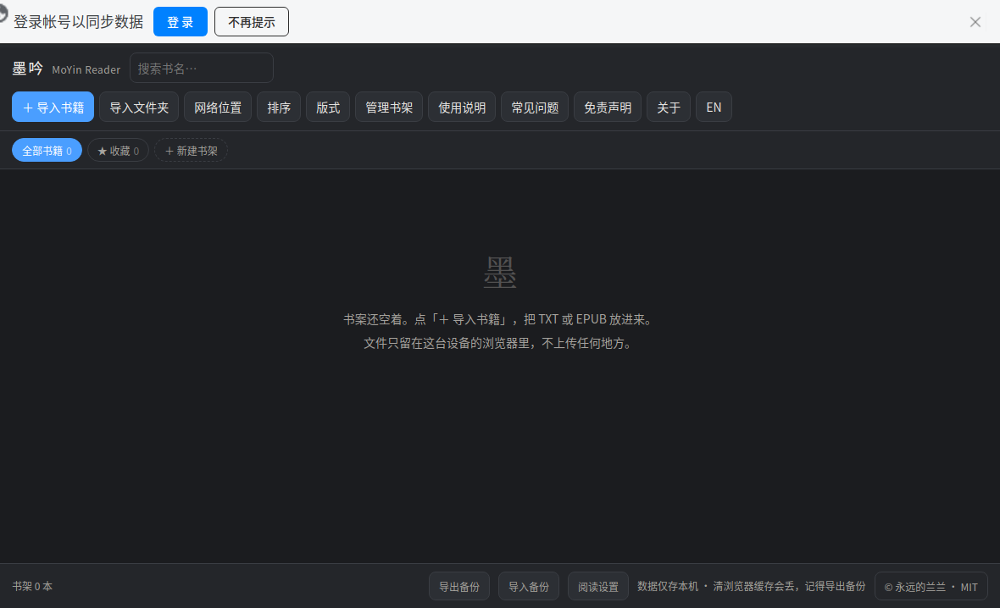

| 翻页 · 双栏 · 1920 宽 | 翻页 · 单栏 · 羊皮纸 |
|---|---|
|  |  |

| 翻页 · 双栏 · 夜间 | 翻页 · 双栏 · 明亮 |
|---|---|
|  |  |

| 主题一处挑完（点卡片即生效） | 护眼绿 |
|---|---|
| 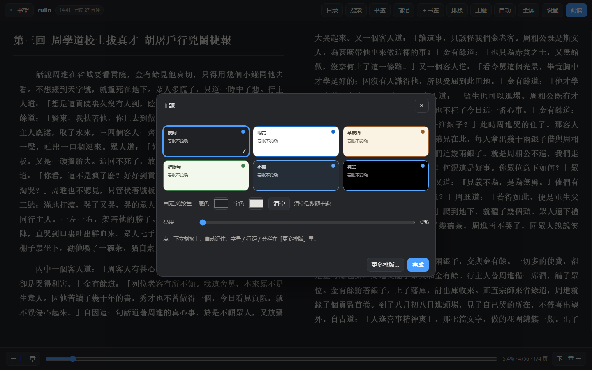 |  |

| 阅读时钟与休息提醒 | 沉浸模式 · 右上角淡时钟 |
|---|---|
| 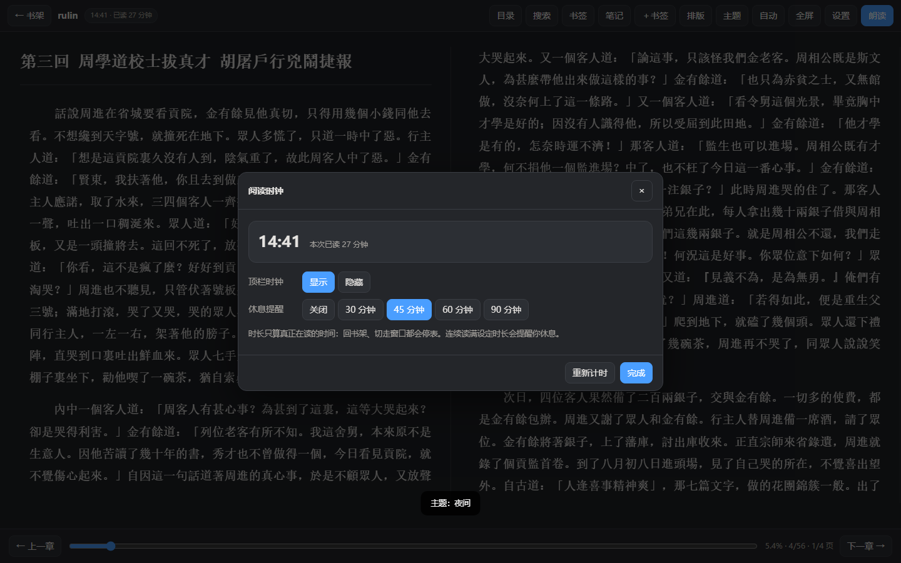 |  |

| 排版与外观（一处调完） | 休息提醒 |
|---|---|
| 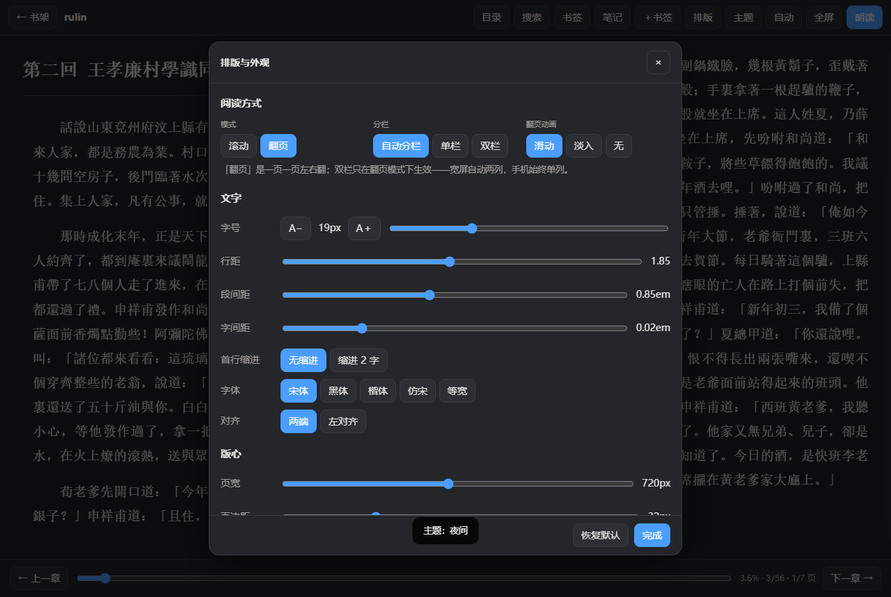 | 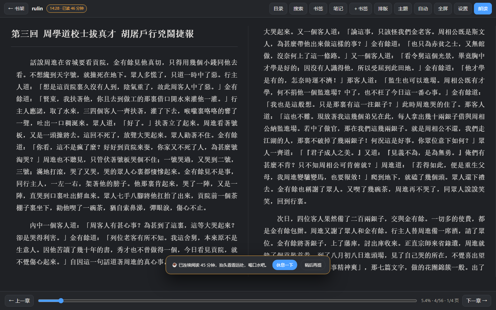 |

| 手机 · 顶栏两行 | 手机 · 选双栏也单列 |
|---|---|
|  |  |

| 分角色朗读 | 书架 · 一键续听 |
|---|---|
| 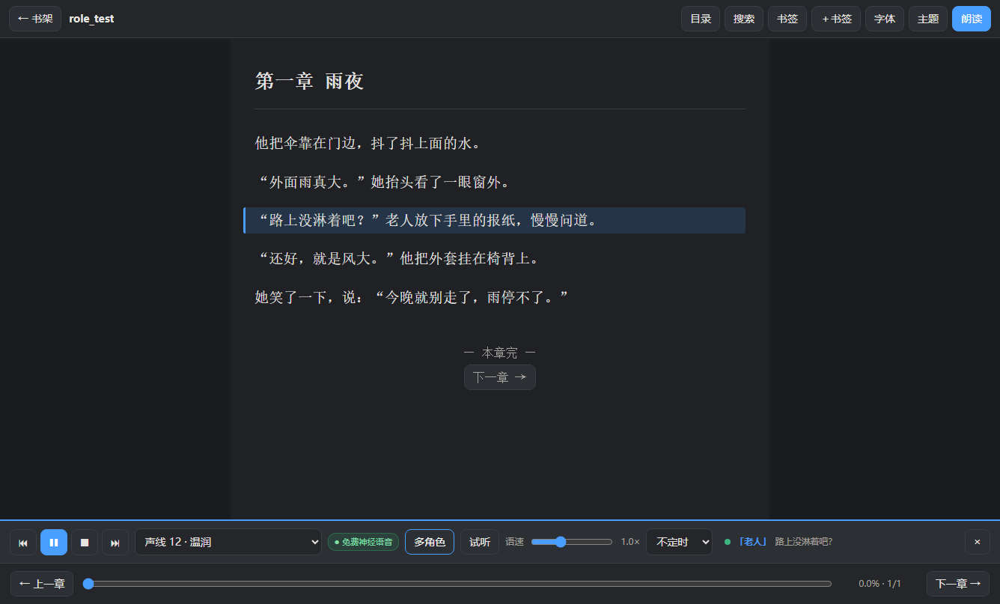 | 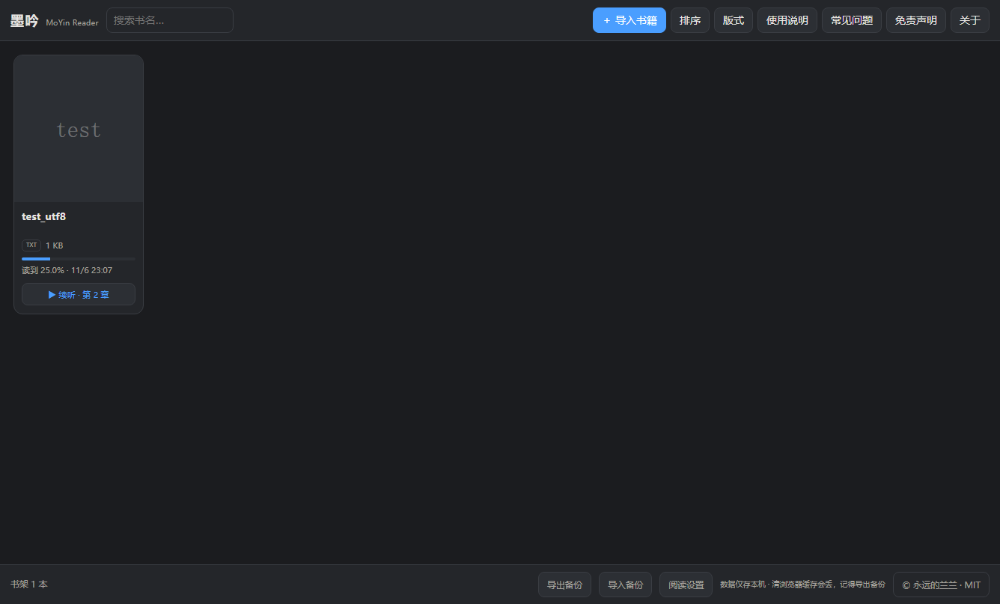 |

| 划线批注 | 阅读总结 |
|---|---|
| 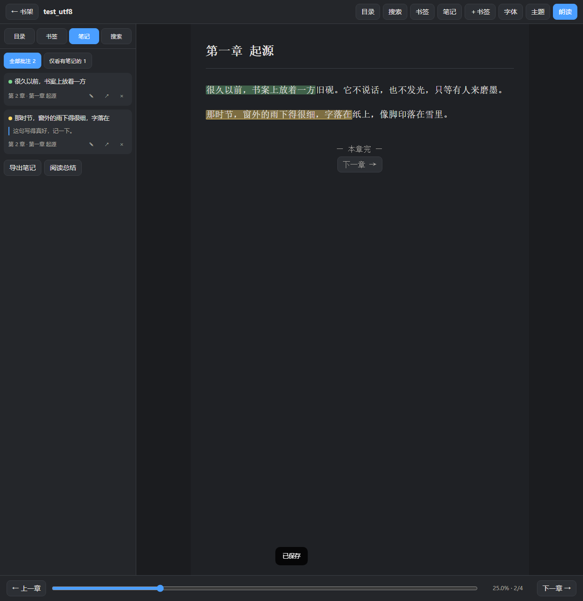 | 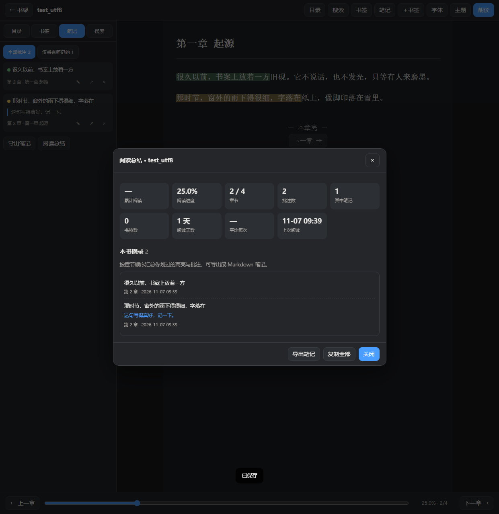 |

| 网络位置 · 读局域网共享 | 187 个离线声线 |
|---|---|
|  | 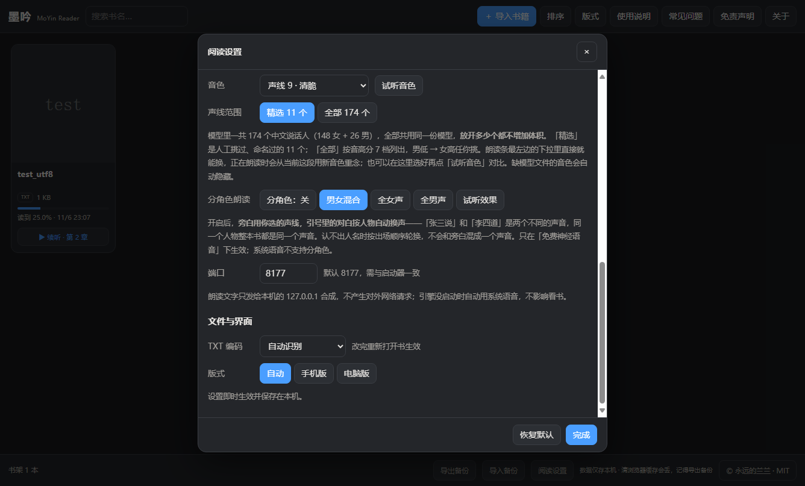 |

| 英文界面 | 分角色朗读 |
|---|---|
| 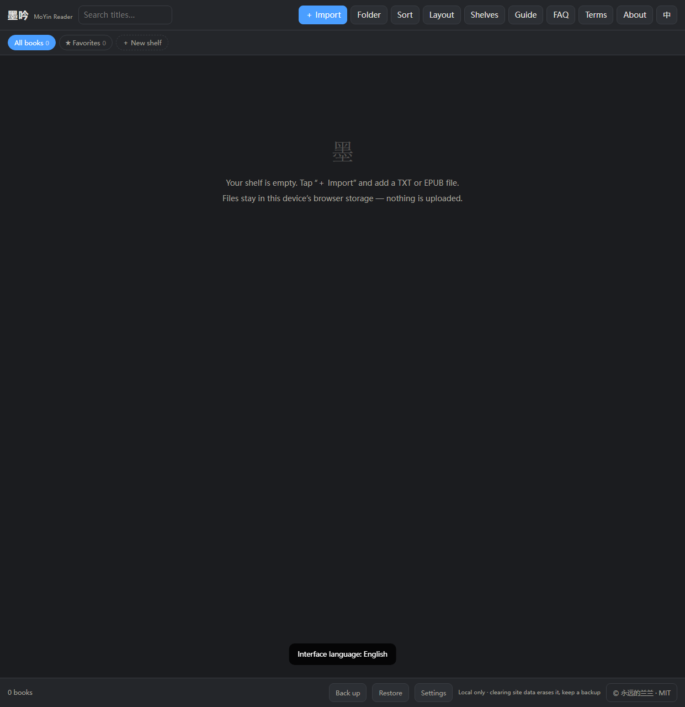 |  |

### 平台

| 平台 | 怎么用 | 说明 |
|---|---|---|
| **Windows** | 下载 `MoYinReader.exe` 双击 | 完整版，187 个离线语音与分角色朗读都在这一版 |
| **安卓** | 打开[下载页](https://podcatcher962.github.io/moyin-reader/download/)选源下载 | 页面内嵌，**187 个离线神经声线随包带走**，断网也能听；下载页会列出官方直链与可选镜像，手机下载见下方说明 |
| **任意系统** | 双击 `MoYinReader.html` | 单文件网页版，功能与桌面版一致 |
| **Linux / 信创**（统信 UOS、麒麟、openEuler、Deepin） | `sudo dpkg -i moyin-reader_*.deb` 装进应用菜单；或用 `MoYinReader-Linux-*.tar.gz` 解压后双击「墨吟阅读器.sh」 | 走**系统自带的 python3** 起原生窗口，没有就用 Chromium 系浏览器的「应用窗口」模式；x86_64 / 飞腾 / 鲲鹏 / 龙芯都一样。**1.14.39 起包里不再附预编译二进制**——旧那个是 1.10 打的、内嵌页面停在 1.10，会盖住新界面（详见下方「Linux 包为什么不再带二进制」）。想要免 Python 就在本机跑一次 `build-linux.sh` |
| **macOS**（Intel / Apple Silicon） | 解压 `MoYinReader-macOS-*.zip`，双击「墨吟阅读器.command」 | 免安装 Python |

> **手机上装安卓版，下载卡住怎么办**
>
> 统一走下载页：**`https://podcatcher962.github.io/moyin-reader/download/`**。页面上并排给出几条路，自己挑：
>
> 1. **官方直链**——直接把请求发给 GitHub，中间没有别的服务器（推荐，先试这条）
> 2. **加速镜像**——`gh-proxy.com` 这类前缀是第三方反向代理在替你取文件，**对方能看到你的 IP 与浏览器标识**，只在直连不通时用
>
> 页面顶部带当前版本、字节数与 sha256，下完可以自己核对（安卓包里 187 个声线 + 引擎共占 100 MB 左右，只下到几 MB 就是没下完）。
>
> 为什么直连会卡：GitHub 的下载先跳 `github.com`、再跳 `objects.githubusercontent.com`，这两跳在国内手机网络里经常十几秒不动或直接被掐断（电脑上能下，多是因为走了代理）；GitHub Pages 的地址段（185.199.108–111.153）在晚高峰后也常被限速，凌晨不等于网络空闲，手机还会优先走 IPv6、部分移动网络到 GitHub 的 IPv6 路由更差。换 Wi-Fi / 流量，或退回镜像，通常就能下。
>
> 三点注意：① 一定要在**系统浏览器**里打开，微信 / QQ 的内置浏览器会直接拦掉 apk，请在右上角「…」→「在浏览器打开」；② 小米 / 华为浏览器可能提示「该文件可能有害」，选「仍要下载」；③ 装之前系统会提示「未知来源」，允许「墨吟」安装即可。

> **为什么安卓包不放在 Pages 上**：100 MB 的二进制每次发版都要整包同步到 CDN，Pages 的部署会在 `syncing_files` 卡到超时（实测 10 分钟被掐断）。所以 Pages 只放一个轻量下载页，包里文件仍由 Release 提供——仓库因此也瘦，克隆不用拖 100 MB。

Linux 包里那个 `MoYinReader` 是在统信 UOS 20 专业版上编译的 ELF，只依赖系统自带的 libc / libz / libpthread / libdl（glibc 2.28+），UOS 20、银河麒麟 V10、openEuler 20.03 及更新版本都能直接运行。窗口用系统浏览器内核的「应用模式」打开——没有地址栏和标签页，是个独立窗口，关掉即退出。

其余架构（aarch64 / loongarch64）仍走 Python 或网页方式；包里附 `build-linux.sh`，可在本机打自己架构的二进制。macOS 同理附 `build-macos.sh`，打 `.app`。

朗读：Windows 完整版与安卓版都自带神经语音（sherpa-onnx + fanchen-C，187 个中文声线，完全离线）；网页版 / Linux / macOS 走系统语音，也可以把同一份 `VoicePack` 放在旁边连本机引擎（`127.0.0.1:8177`）。

### 功能

| 类别 | 说明 |
|---|---|
| 📚 格式 | TXT（自动识别 UTF-8 / GBK / Big5 / UTF-16）、EPUB（内置 ZIP/OPF/NCX/Nav 解析，正文与插图都支持） |
| 🗣️ 朗读 | 一份 16 kHz 的中文多说话人库：**187 个真人声线**（39 男 148 女，148 女里含 2 个童声），共用一份 61.4 MB 半精度 fp16 模型（int8 只有 41 MB 但实测字错率从 11% 升到 25%，发音会糊，所以不用 int8）。按实测基频分 7 档，**桌面端精选 50 条、安卓端 30 条**，**任意一条都能设成主角**，朗读条随时切换。1.14.39 起全部常驻内存、靠 `sid` 换人，一句二十字约 0.9 秒；分角色朗读时一句话一个人一个嗓子 |
| ⚡ 不等 | 1.14.8 起语音引擎**常驻内存**（sherpa-onnx 的 Python 绑定 + 实例池），不再每句起一次进程：短句从 1.9 秒降到 0.19 秒，长段对白从 9.9 秒降到 2.7 秒。换了进程残留的旧引擎也能自动认出来重起，不会「升级了没变化」 |
| 🎭 分角色 | **默认开启**：旁白用所选声线，对白按人物换声，同一人物全书同一声音。开口前先把本章前后几章的人物一次性配好声线（人物表），「他 / 她」这类代词绑回最近那位实名角色，不另占声线；没写是谁说的短对白按一问一答推定，也只用已定好的那位。认识「张三说」「他盯我一眼，说」「我说」「他突然问我」，不会把「我对某人说」的听话人当说话人；人物多时声线池自动从精选扩到全部 187 个 |
| 🔤 英文 | 中文模型一个英文字母都不认识（实测 68 012 条词条，连 `hello` / `OK` / `CPU` 都查不到）。纯英文句子按三条路走：装了英文模型就用本地神经语音念；没有就用系统英文语音；都没有就按字母数留白 0.5–4.5 秒再往下念，**只轻提示一次，不弹窗、不降级、不切机械音**。中英混排照常用人物声音念中文，英文词另交给英文模型（桌面完整版与安卓完整版随包自带，轻量版可另行安装） |
| 🩹 容错 | 只有标点的块（「？？？」「……」）按符号长度留白，不送合成、不报错；单句没合成出来只跳这一句，段里其它照念；连不上引擎或连着几段都出不来才退回系统语音，且这一场不再中途切回来 |
| 🔢 数字与符号 | 朗读前先把阿拉伯数字换成汉字读法，再把数字旁边那些「念不出来的符号」换成人话。数字：`1934年4月13日` → 「一九三四年四月十三日」，`2026上半年` → 「二零二六上半年」（年份逐位，后接量词才按数值）、`12:30`、`63%`、`3.5公里`、`50000元`、手机号（逐位）都对。符号：`-2.08` → 「负二点零八」、`+42,933` → 「正四万二千九百三十三」、`>0.05` → 「大于零点零五」、`3~5` / `60-52` / `1月5日-29日` → 「到」、`->` → 停顿、`2.` → 「二、」。中文模型的词典里没有一个阿拉伯数字，符号更是一个都不认——不换就等于把它们整段吞掉 |
| 🎚️ 声线自由配置 | 朗读条上**只有「原版」男女主不可删**（删了就没默认声音兜底），其余全部自由：六个音高变体、187 个配角、自己挑的，都能删能加，置顶位 **女声 10 + 男声 10**。点 × 只从朗读条移除，声线本身没丢，随时加回来 |
| 🎭 角色统计 | 朗读设置页直接显示这本书「认出几个人物 · 用掉几个声线（女 / 男）」，旁边「识别一遍」可以当场重排，不用先点朗读 |
| ⏯️ 听书 | 段落高亮自动跟随、念完自动接下一章、定时停止、语速调节、整句朗读保语调 |
| 🖍️ 划线批注 | 选中正文四色高亮、随手写笔记；「笔记」页按章汇总，可跳转 / 改色 / 编辑 / 删除 |
| 📤 导出分享 | 笔记一键导出 Markdown；划线生成带书名与署名的分享图（PNG），也可只复制文字 |
| 📊 阅读总结 | 累计时长、进度、批注 / 书签数、逐章摘录一页看完，可复制或导出成笔记 |
| 🗂️ 书架 | 自建书架分组、★收藏、批量移动 / 移除、改书名作者、整目录导入、阅读计时 |
| 📄 PDF | 导入 PDF 时把**文字层**逐页抽出来，按章节排好，阅读 / 朗读 / 划词 / 笔记 / 繁简全部照常；抽出的正文随书存在本机，第二次打开不再重解。扫描件（整页图片）与字体没带 Unicode 映射的 PDF（抽出来是乱码）会当场说清原因并跳过，不塞进书架 |
| 📥 拖拽导入 | 把 TXT / EPUB / PDF / DOCX / MOBI / AZW3 / ZIP（或整个文件夹）直接拖进窗口，松手就导入，正在看书也不打断。压缩包在内存里解开，包里只挑书，图片与说明文件自动跳过 |
| 🖧 网络位置 | **桌面版**可直接读局域网共享（SMB）：填 `\\192.168.1.10\Books`、映射盘 `Z:\书` 或本机任意路径，像本地文件夹一样扫描导入，凭据交给 Windows 记住 |
| ☁️ 网盘同步（**实验性**） | 设置里填 WebDAV 地址与**应用密码**就能跨设备接读（坚果云、InfiniCLOUD、Nextcloud 都行）。只同步进度 / 书签 / 批注 / 分组，**不传书文件**：每本书有「内容指纹」（体积 + 书名 + 首尾各 8 KB 摘要），同一本书在另一台机器导入后进度自动接上，一个字节都不用搬。进度只前进不倒退，笔记两边都留（按内容去重）。默认关闭；密码只存本机，不进设置、不进备份、不上传；网页版没有本地通道，UI 上直说用不了 |
| 🌐 双语 | 全窗口中英切换（含设置、弹窗、提示与全部说明文档），选择记住 |
| 🔖 续听 | 「听到哪」与「读到哪」分开记，书架卡片一键「续听 · 第 N 章」接着念 |
| ✍️ 阅读 | **滚动 / 翻页**两种读法：分栏只有**自动 / 单栏 / 双栏**（够宽自动双栏、手机永远单栏，选双栏自动切翻页）。字号、行距、段间距、字间距、首行缩进、**十种字体**、两端 / 左对齐、版心宽度、页边距全部可调 |
| 🈵 繁简 | 设置里一键把繁体书显示成简体（OpenCC 对照表，2965 个常用字）；**只改显示、不动原文**，关掉即还原，划线笔记位置不受影响 |
| 🖼️ 插图 | EPUB 里的地图、人物关系表、插图页点一下全屏看，点任意处或 Esc 关闭 |
| 🎨 主题 | 六套配色（夜间 / 明亮 / 羊皮纸 / 护眼绿 / 雾蓝 / 纯黑），点「主题」弹出卡片一次挑完；另有 8 种常用字色 + 8 种底色色板与取色器，选深底会自动配浅字 |
| 🕐 时钟 | 顶栏显示当前时间与本次已读时长，30 分钟转黄、60 分钟转红；沉浸模式右上角保留淡时钟 |
| ☕ 护眼 | 连续读满 30 / 45 / 60 / 90 分钟（可关）提醒休息，可「休息一下」重新计时或「稍后再提」 |
| ▶️ 自动阅读 | 滚动模式匀速下滚（速度 1–10），翻页模式按秒自动翻页（**停留 3–180 秒可调**）；一键暂停 / 继续，章末自动接下一章 |
| 🖥️ 沉浸全屏 | 上下工具栏自动收起，鼠标移到屏幕边缘唤出；F11 / Esc 快捷键 |
| 🔍 导航 | 目录跳章、全文搜索、书签、章节内跳转；翻页模式下点两侧、滚轮、空格、← →、手机左右滑都能翻页 |
| 💾 数据 | IndexedDB 本机存储，可导出/导入备份（含书籍文件），换设备不丢 |
| 🔄 检查更新 | 设置里点一下，读出新版本号、该下哪个包、多大、sha256，并给出下载入口。**默认不自动查**——本软件平时不联网，只有你点了才发一次请求（约 90 KB，不传任何本机信息）；想自动查自己在设置里开，开了也一天最多一次，断网时静默不打扰 |
| 🔒 隐私 | 默认零联网；语音在本机 127.0.0.1 合成，朗读文字不出本机 |

### 下载什么

| 文件 | 体积 | 说明 |
|---|---|---|
| `MoYinReader.exe` | 约 125 MB | **Windows 完整版**，语音库打包在 exe 尾部，只拷这一个文件就能听，首次启动自动释放到缓存（实测 4.8 秒）。1.14.8 起内置常驻语音引擎（sherpa-onnx 的 Python 绑定）；1.14.20 起英文女声也打进来了（`en-ljs`，约 39 MB）。**1.14.40 起不再带两份 22 kHz 主角模型**（xiaoya + chaowen，压缩后 25.2 MB），150 → 125 MB |
| `MoYinReader_Lite.exe` | 约 38 MB | Windows 轻量版，需同目录放 `VoicePack` 文件夹（约 133 MB） |
| `MoYinReader.apk` | 约 102 MB | 安卓完整版（arm64-v8a），页面 + 187 声线语音库 + 英文模型与引擎全在包里（1.14.40 起不带 22 kHz 主角模型，128 → 102 MB）。187 人配角库用 fp16 而非 int8，所以比 1.14.2x 那会儿大，换来的是每个字都咬得清 |
| `MoYinReader.html` | 约 2.1 MB | 单文件网页版，双击即用，任何系统都能跑（1.14.25 起内置 PDF.js，体积从 0.5 MB 涨到 2 MB，换来 PDF 能读） |
| `moyin-reader_*_amd64.deb` | 约 0.7 MB | 统信 / 麒麟 / openEuler，**双击安装即进应用菜单**，卸载走系统正常流程。1.14.39 起不再捆旧二进制，体积从 9.8 MB 降到 0.7 MB，装得更快也更好修 |
| `MoYinReader-Linux-*.tar.gz` | 约 0.7 MB | 免安装版：解压双击「墨吟阅读器.sh」，U 盘带走也能用 |
| `MoYinReader-macOS-*.zip` | 约 0.7 MB | macOS 源码 + 打包脚本，在本机跑一次 `build-macos.sh` 出 `.app`（内含的页面就是当前版本，跟 Win 版同一个 md5） |

### 这 125 MB 里到底是什么

总有人问「一个阅读器为什么 125 MB」。把 exe 尾部的语音包拆开量一遍，账是这样的（2026-11-13 实测，LZMA 压缩后计入 exe）：

| 组成 | 原始 | 压进 exe 后 | 说明 |
|---|---:|---:|---|
| Python 运行时 + 页面 + 语音服务脚本 | — | 38.4 MiB | 阅读器本体，含 2.2 MB 的单文件页面 |
| fanchen 187 人语音库 | 75.5 MB | 58.3 MB | 一份模型 + jieba 词典 + 词表，187 个人共用，**加人不加体积** |
| en-ljs 英文模型 | 41.1 MB | 26.5 MB | 中英混排里那些英文词靠它念 |
| sherpa-onnx 运行时 | 23.2 MB | 6.0 MB | `onnxruntime.dll` 等 5 个文件 |
| shared 词典与数字 / 电话规则 | 2.3 MB | 0.5 MB | 声线库共用的分词与读法规则 |
| **合计** | **142.2 MB** | **87.3 MB + 38.4 MiB ≈ 125 MiB** | |

**1.14.40 之前的 150 MB 是怎么来的**：那时候还带两份 22 kHz 主角模型（女声 18.65 MB + 男声 18.65 MB），压缩后合计 25.2 MB。187 人那套常驻之后一句 0.92 秒、跟主角同速，那两份的优势只剩「采样率高一点」，于是被拿掉了——**这是省体积的唯一一处，其余一个字节都没动**。想再小就只能砍英文模型（-26 MB），代价是中英混排里的英文词只能跳过或走系统语音。

那两份模型也**不再进仓库**（`VoicePack/models/` 整个目录都在 `.gitignore` 里），安装器从 1.14.40 起也不再下载它们——女声那份的训练数据明写「**仅限非商用**」，留在默认下载链上有合规风险，男声与之同源。老用户的 `VoicePack/models/` 里若还留着 `xiaoya` / `chaowen`，语音服务仍会认出来（向后兼容，不用改一行代码）；想彻底清掉，删掉这两个目录即可，187 条声线一条不少。

不想自己构建的话，直接到 **[Releases](https://github.com/podcatcher962/moyin-reader/releases)** 下载编译好的版本；或者用 **[在线版](https://podcatcher962.github.io/moyin-reader/)** 什么都不装。

### 最近改动（1.14.8 → 1.14.41）

从 1.14.8「不再等十秒」到 1.14.41「把许可说清楚」，一共三十多个版本。按批次写在下面，新的在前。

**1.14.41 · 只改文字：把 MIT 覆盖到哪、谁在用模型商用、怎么提异议，都写明白**

功能一行没动，朗读、排版、导入、进度与 1.14.40 完全一致。改的全是「出事时能拿出来的那部分」：

- **划清 MIT 的边界**：MIT 只覆盖本项目自己写的代码与文档，**不覆盖随包的语音模型与引擎**。它们属于上游，本项目只做原样再分发，**无权授权、不作再许可**。任何人拿模型去商用，都不能援引本项目的 MIT 声明——那份声明对它们无效。这条同时写进 `README`、`THIRD-PARTY-NOTICES`、`VOICE-POLICY` 与软件内「开源与许可」页，四处同口径。
- **加一句「不认代收费」**：墨吟永久免费，作者没有授权任何人以本项目的名义收费、代充、捆绑销售或做「付费版」。花钱买到的属于卖方行为，与本项目无关。
- **异议入口从「见 README」改成具体地址**：`github.com/podcatcher962/moyin-reader/issues`。原来那句在 APK 里根本落不了地——手机用户手上没有 README。
- **22 kHz 旧模型改名**：「墨吟 · 女声 / 男声」→「旧版 22k · 女声 / 男声」。老 `VoicePack` 目录里还留着它们照样能选，但名字里不再挂「墨吟」，免得被当成软件自带的声音。
- **声线命名复核**：精选 50 条是「档位 + 序号」，其余 137 条显示为「音色 N」，全部无名无姓、不指向任何具体的人。

**1.14.40 · 把两份 22 kHz 主角模型拿掉，包小 25 MB**

1.14.39 让 187 个人全部能当主角之后，「主角」这个身份就不再需要靠一份单独的模型撑着。这一版把那两份 22 kHz 模型（旧版女声 / 男声，各 18.65 MB）从安装包里拿掉——**不是删文件，是不再打进去**：

- **桌面 exe 150 → 125 MB，安卓包 128 → 102 MB**，常驻内存基线从 390 MB 降到 250 MB（少开两个池）。
- **默认旁白换成真人声线**：以前是「旧版 22k · 女声」，现在落在精选里的「成年女 1」；男声默认「中年男 1」。选过别的声线的不受影响。
- **老配置不会哑**：配置里还存着 `x0` / `c0` / `f1~m3` 的，升级后自动落到新的默认，不用重新挑。
- **精选补两条**：拿走两条主角后补位成 50 条——「中年男 7」（162 Hz，填 140~165 的中段）与「青年女 15」（263 Hz，接原来 x0 的位置）。原来 48 条 sid 一个没动。
- **安装器也不再下载这两份**：`VoicePack/install.py` 的下载清单去掉了 `v_xiaoya` / `v_chaowen`（女声那份训练数据授权为「仅限非商用」，男声同源）。老用户目录里若还留着，语音服务照旧识别——向后兼容，不改一行代码。

为什么敢拿掉：音质上它们确实更细腻（22.05 kHz，齿音与气口都在），但 187 人那套常驻之后一句 0.92 秒、跟它们同速，差的只有采样率本身。这个软件从第一天起写的是「**用普通人的声音，讲普通人的故事**」——187 个人就是这句话的实体，那两份「受过训练的嗓子」反而是异类。省下来的 25 MB 换一个更小的包。

**1.14.39 · 187 个声音，全部能当主角**

这一版只做一件事：把「配角」两个字从产品里去掉。

- **187 人那份库接进常驻引擎。** 以前只有两份 22 kHz 主角是常驻的，配角库每念一句都要重起一次进程（载模型 1.9 秒），实测一句 12 秒——所以桌面端只敢把 8 个「音高变体」放进精选，真正的人声全藏在二级菜单里。这次把它也接进常驻池：同一份 fanchen 模型、只靠 `sid` 换人，**一句 19 字实测 0.92 秒**，与 22 kHz 主角（0.91 秒）持平。省下的时间全换成了可选的声音，一个字节的模型都没多。
- **桌面精选 30 → 50 条。** 新加的 18 条不是随手挑：补的是各档原本空着的音高位置——男低沉补到 4 条、男偏高补 2 条填住 182 Hz 以下的低端（原来 5 条全挤在 182~194）、女低音 / 成年 / 青年各补几条，女高音第一次有了成年女声（以前这一档只有两个童声）。**原来的 30 条 sid 一个没动**，你选中的声音还是同一个。手机屏小、一次翻不完，保持 30 条。
- **「置顶」就是「设为主角」，写在界面上。** 设置页那一栏改叫「我的主角声线」，朗读条下拉标成「📌 置顶＝主角 · 女声 / 男声」——点哪个名字朗读立刻换哪个，不用先挑一次再设一次。点 × 只从下拉里移除，不会取消正在念的声音。
- **男女主角下拉放开全库。** 不再只列前 12 个，同性别的一条不漏（男 43 / 女 152，共 195 条）；组名只报本组条数，修掉「全部 152 个」却只列了 140 条的错标。
- **第一次打开给 20 个推荐。** 男 9、女 10、童 1，青年占四成，低沉只留一条——以前前八张卡全是低沉和中年男，还没滑到女声就把窗口关了。
- **旁白可以分男女两条。** 同一本书适合女声娓娓道来，另一本可能适合男声沉稳；两条各记各的，换书不用重新翻声线表。
- **配角池只开一个实例。** 三套池全建起来 737 MB → 560 MB，稳态速度没差；开念时后台把三套一起预热，第一句对白不再冷等 9 秒。

**1.14.29 ~ 1.14.35 · 六种书都能进来**

这七版的主线是「拿到手的书，先能打开」。以前只认 TXT / EPUB / PDF，现在按读者的实际书堆补齐：

| 能进来 | 怎么做 | 边界说清楚 |
|---|---|---|
| `.zip` 压缩包 | 拖进来整包导入，内存里解压，不往你的文件夹写一个字节 | 只认书，包里的图片、说明文件、Mac 资源叉自动跳过；GBK 老编码的 txt 也能读对 |
| `.docx` | 正文一个字不少，表格里的字按行读出来，章节按标题自动分 | 老版 `.doc`（97-2003 二进制）读不了，会直说「另存为 .docx」 |
| `.mobi` / `.azw3` | Kindle 两种格式自己解压、自己认章节，不装 Kindle、不联网 | 带 DRM 的明说「要去 DRM 才能读」；少数用 Kindle 私有压缩（HUFF）的，会建议先用 Calibre 转 EPUB |
| 扫描版 PDF | 按页渲染成图片进阅读器，翻页、目录、进度条、书签、封面全照常 | 图上的字机器不认识，所以不能朗读 / 划词 / 笔记——点朗读会直说「这本只能看」，不含糊成「引擎故障」 |
| 水印扫描书 | 导入时先量每页图像占比，整页是图且文字少得可怜就按扫描件打开，直接给原页 | 有些书被塞了一层「加微信领书」的水印，以前会打开满屏重复的水印句 |

朗读这边同时修了一批「一句话说没就没」的问题：换声线不再「没声音 + 弹窗」（分清了「引擎还在准备」和「真坏了」，连着 3 次才算坏）；打开软件不再干等十几秒（只在你真打开一本书时才建会话）；句子里夹一个 `CPU` / `WiFi` 这类英文词不再整句跳过（英文词单独念，不认识的按字母念 C-P-U）；`DOCX` 里的英文段落交给单独的英文模型；安卓念英文从「念一行、停很久、跳掉一大段」修到「按句子切、绝不劈词」——根因是 Java 切句循环里句末标点表有半角 `.`、跳过标点表没有，读到英文句号时下标原地不动成了死循环，而它攥着旁白那把锁，一句英文能把后面所有中文一起拖死。

**1.14.28 · 换台机器接着读（网盘同步 WebDAV）**

有人问「能不能两台机器接着读」。做的不是「把书传上去」，而是**只对号、不搬书**：

- 每本书算一个内容指纹——体积 + 规范化书名 + 首尾各 8 KB 的 SHA-256 前 16 位。不 hash 全书，是因为 20 MB 的书在手机上要几百毫秒，而导入本来就慢；体积加首尾已经足够区分。老书在第一次同步前自动补算，后台一本一本过，不挡书架。
- 同步的只有进度、书签、批注、分组（连书文件是下一步的事）。一台机器读到 50%，另一台把同一个文件导进去，指纹一对，直接翻到第 50%——**书文件一个字节都没传**。这也是为什么先做指纹：不做它，同步来的进度认不到书，只会留下一堆「有进度没文件」的幽灵条目。
- 合并讲三条：进度只许前进（`progress` 取大，章节跟着走，不出现「60% 却停在第 3 章」）；笔记两边都留、按内容去重（手写的东西宁多勿丢）；其余以最后读的那台为准。
- 三个约束写在代码最前面：① WebDAV 服务几乎都不发 `Access-Control-Allow-Origin`，页面里 `fetch` 必被拦，所以请求交给本地壳发（桌面 Python `urllib`、安卓 `HttpURLConnection`），网页版永远不支持，UI 上直说；② 应用密码单独存 `MOYIN_WD`，**绝不进 CFG**——`exportBak` 是 `Object.assign({}, CFG)` 全量导出，进了 CFG 就等于跟着备份文件走；③ 默认关闭，守「默认零联网」。
- 安卓侧踩到一个坑：`HttpURLConnection.setRequestMethod()` 不接受 `MKCOL` / `PROPFIND`，会抛 `ProtocolException`。所以探测连接改用 `GET`（200 和 404 都能说明「连得上」），远端目录默认留空写根目录。
- **这一版是实验性的，把话说在前头**：协议层全部验过（PUT / GET / 中文往返 / 鉴权 / 拒绝错误密码 / 令牌门），但手边没有网盘账号，**没在真实网盘上跑过**。所以它默认关闭，填完连不上、同步不上都属正常；愿意先试的人才是这一版的测试者，有问题留言即可。感谢 **@千杉、@云中书简、@ronin、@_城南** 提出这个需求——「书在两台机器上，读到哪儿了总接不上」这句话是他们先说出来的。

**1.14.27 · 声线全放开，选择权给用户**

手机外放实测推翻了之前的一个判断：男声那点「沙沙」在手机喇叭上基本听不出来，要接功放或高解析耳机才会被放大——**设备把失真和噪声放大了，不是每个人都需要降噪**。于是三档保留、默认改成「原声」：觉得干净就别动，接音箱听着吵再往上调一档。

同时把声线的处置权全交出去。朗读条上固定的只剩「女声 1 · 原声」「男声 1 · 原声」两个——它们是兜底，删了没声音；六个音高变体、187 个配角、自己挑的，一律能删能加，置顶位从 6 个放宽到 **女声 10 + 男声 10**。顺带修掉一个真 bug：`fixPinBalance` 还按旧的「内置 8 个」跳过变体，导致变体不占配额、超了也不削平。

说清一件事：这套中性音色不合耳朵很正常。我们不做录音棚那种一尘不染的嗓子——**用普通人的声音，讲普通人的故事**，声音越普通，故事越有真实感。187 个人声，总有一个让你心动的声音。

**1.14.26 · 数字读对了，符号也读出来了**

1.14.25 把数字换成了汉字，但只换了「数」，没管「语境」和「符号」。三处实测出来的毛病：`2026上半年` 念成「两千零二十六上半年」（年份该逐位念）；`每股价差：-2.08元` 念成「二点零八元」、`价差>0.05元` 念成「零点零五元」，**正负大小全丢了，意思正好反了**。这一版给符号补上读法（负/正/大于/小于/大于等于/小于等于/区间「到」/箭头停顿/竖线/行首序号），并让四位年份按语境分流：后接量词（2026人、2026元）仍按数值，其余逐位。日期 `2026-01-05` 不再被拆成两个数，整段念「二零二六年一月五日」。只有**标点**可以省（那是停顿，不是语义），排版线（`====`、`----`）也不算符号。其余一律读出来，这条定为底线：**常用符号宁可多读，绝不省略**——听书时听见「大于」「负」「美元」很正常，漏一个可能把话读反。57 个用例全绿。

**1.14.25 · PDF 能读了，数字不漏了**

两件积压最久的事。PDF：内置 PDF.js（Apache-2.0）只取**文字层**——逐页抽字块、按 y 聚行、去掉跨页重复的页眉页脚、按行距与首行缩进并段、认章节标题，抽出来就是一本普通文本书，阅读 / 分角色朗读 / 划词 / 简繁转换全都在。几百页的册子抽一次要几十秒，所以正文随书存进本机，第二次打开直接还原章节。扫描件（整页是图片）和字体没带 Unicode 映射的 PDF（抽出来只有符号和数字）会**明确说读不了**，不会把一屏乱码塞进书架。数字：「1934年4月13日」以前只念得出「年月日」，数字整段消失——配角库那 187 个说话人共用的模型没有数字规则，阿拉伯数字进去就被吞。现在朗读前统一换成汉字（年月日 / 时刻 / 百分比 / 金额 / 手机号逐位 / 小数），跟用哪个声线、哪个平台都无关。另加：朗读设置页直接显示「这本书的角色：N 个角色 · 用掉 M 个声线（女 x / 男 y）」；英文书导入时就说明手机版没有英文语音模型，不再静悄悄地不出声。

**1.14.8 · 不再等十秒**

多角色朗读最刺耳的不是音色，是空白。查下来两个真原因：每念一句都要起一次 `sherpa-onnx-offline-tts` 子进程（同一句 1.9 秒里 1.8 秒在载模型），以及配角全挤在 16 kHz / 187 人的慢库上（一句十几秒）。改成常驻引擎 + 实例池，配角也换成 22 kHz 快模型的音高变体，实测：短句 1.90 → 0.19 秒，长段对白 9.9 → 2.7 秒。

**1.14.9 · 一个人一个嗓子**

「一段对话男声女声不停变」的根子是：认不出说话人就随手挑一个「用得最少」的声线，而且不记账。现在开口前先扫本章前后几章、按提及次数把人物表定死（写进书里，整本沿用），代词绑回最近的实名角色，认不出的短句沿用上一位。一本书里同一个人只有一副嗓子。

**1.14.10 · 问号不再换人**

「？？？」「……」这种整段只有标点的地方，引擎判空文本回 HTTP 500，页面当成引擎坏了就切回系统机械音。现在服务端对这类请求返回**等长静音**，页面按符号长度留白（一个问号约 0.3 秒），后面照常用原声念。同时把「一句失败」拆成只跳这一句，只有连不上或连着六句失败才降级；刚打开软件点朗读会先等引擎最多 8 秒，开头几句不再变成机械音。

**1.14.11 · 英文不炸**

中文模型的词典里一个英文字母都没有，以前整段英文进去就是「一个字都没念出来」，500 之后整章退回系统朗读。现在纯英文走系统英文语音（语言换了，声音本该换人），没有就留白跳过；安卓端同理，不再弹「语音没有出声」把整场朗读卡住。中英混排里的英文词可以再装一个可选的英文模型（`VoicePack/models/en-ljs/`，约 40 MB，**未随包**），装了之后 `WiFi`、`iPhone` 这类词也有人念；没装只跳过那个词，中文不受影响。

**1.14.12 · 手机上手顺了**

真机上最难受的两件事：顶栏占掉一百多像素还不肯走，翻页只能靠手指滑。现在顶栏压成一行（返回 / 书名 / 时钟 / 目录 / 朗读 / ⋯），其余动作收进浮层面板，展开也不撑高；点屏幕中间上下工具栏一起收起，正文占满整屏，再点中间或点顶部窄边唤回。默认改成**翻页**：点右边三分之一翻下一页、左边三分之一翻上一页，中间留给选字和「朗读从这里念」，到章末自动接下一章。老配置只要没手动选过阅读方式就跟着切，选过的保持原样。

**1.14.14 · 配角声线不再「每段等半分钟」**

上一版把「点了没声音」修好了，新问题浮出来：用配角声线时，每换一段都要等半分钟，还每段弹一次提示。查下来不是缓存的问题——是那份 187 人语音库的 int8 模型。当初为了省 80 MB 用了**动态量化**，189 个卷积层全变成 `ConvInteger`，而 onnxruntime 的 CPU 后端对这种算子只有参考实现，走不到优化内核。同一句话实测：原版 fp32 **0.66 秒**，动态量化版 **12.9 秒**，慢了 20 倍；换到手机上就是每段等半分钟。

改用**静态量化（QDQ）**后，卷积走 `QLinearConv` 的优化内核：同一句话 **12.9 秒 → 0.24 秒**，比原版 fp32 还快一倍多，体积 33 MB（原来 39.8 MB）。187 个声线、音色、语速一个都没变，安卓包反而小了约 7 MB。「正在准备语音库」的提示改成只在库真的没建好时出现一次，热了就不再打扰。

**1.14.17 ~ 1.14.22 · 从「能跑」到「能给别人用」**

这几版的主线不是加功能，是把「拿到手能不能正常读完一本」补齐。

*体积*：int8 无论怎么压都会把字错率从 11% 推到 25%、还带一层沙沙的底噪，彻底放弃，改用**半精度 fp16**——模型 121 → 61.4 MB、APK 158 → 101 MB，字错率 11.6% 与原来持平，合成速度不变。

*导入*：国产 ROM 的 MIME 库里没登记 `.epub`，按类型筛时一本都看不见。改成 MIME 白名单 + 文件头判断，列表里只剩 TXT 与 EPUB；「导入文件夹」换成系统目录选择器，选一个目录递归扫完批量入库。

*翻页*：插图或字体没加载完就量页，会把整章算成一页，于是「下一页」直接跳章。现在量完用滚动宽度复核、插图加载后补量一次、以为到末页时再复核一次，三道保险。

*声线*：把 21 个精选逐个测了基频，发现「青年男」给了四个、实测只有一个是真青年（其余 133/144/151 Hz 都在中年区间），按实测改成中性名（中年男 4、男声 · 中音 1/2、青年男 1、女声 · 低音 1）。**只改名字，模型一个字节没动**。同时测出另一件事：男声「闷」不是底噪问题（男女平均底噪只差 3.6 dB），而是男主角色的高频细节只有女主的三分之一——这条还没修，要试听后再定。

*诊断*：朗读起不来时，报错弹窗里可以一键复制诊断（版本、包类型、机型、引擎自检、手机里有几个中文语音），贴在评论里就能定位；「关于」页也会写明当前这个包到底带不带离线语音，避免装着 Lite 版却照着完整版的说明去系统设置里折腾。


### 使用

1. 双击 `MoYinReader.exe`（或 `MoYinReader.html`）。
2. 「＋ 导入书籍」选一本 `.txt` / `.epub` / `.pdf` / `.docx` / `.mobi` / `.azw3`，或者直接把书（甚至一整个 `.zip`）拖进窗口。
3. 点书打开，点右上「朗读」开始听；朗读条最左边可换声线。
4. 回到书架能看见「▶ 续听 · 第 N 章」，接着上次听的地方继续。
5. 选中正文任意一句即可高亮、写批注、复制或生成分享图；右侧「笔记」页汇总全部批注，可导出 Markdown 或打开阅读总结。
6. 想换版式点顶栏「排版」：切滚动 / 翻页、选单栏或双栏（选双栏会自动切到翻页，TXT 和 EPUB 一样）、调字号行距段距、换六套主题；点「自动」进自动阅读，点「全屏」进沉浸阅读。
7. 书架顶栏右侧的 `EN` / `中` 一键切换界面语言。
8. 想知道有没有新版本：设置面板右上角点「检查更新」。**点了才联网**，不点永远不联网；下载完先看文件大小，对不上就是没下完。

### 语音是怎么来的

朗读用的是开源引擎 [sherpa-onnx](https://github.com/k2-fsa/sherpa-onnx)，全部在本机 CPU 上跑：不联网、不收费、不需要账号和 Key。成品里只有一套：fanchen-C 中文多说话人 VITS，16 kHz，187 个声线靠切换说话人编号（`sid`）换人，所以**放开到 187 个也几乎不增加体积**。它在 1.14.39 之前合成慢（同样一句话约慢十倍），只当配角；**1.14.39 起把它放进常驻引擎**（同一份模型、靠 sid 换人），一句 19 字实测 0.92 秒，桌面端精选因此从 8 条扩到 50 条，安卓端走另一套 JNI 桥、精选保持 30 条。**1.14.40 起不再随包附带两份 22 kHz 主角模型**（旧版女声 / 男声，各 18.65 MB）：它们确实更细腻，齿音与气口都在，但代价是安装包大 25 MB，而 187 人那套常驻之后速度已经没有差别——按「用普通人的声音讲故事」这个定位，把这份体积换掉了。想听回去随时可以：模型留在本机 `VoicePack/models/` 里，拷回去就认（旧版安装包已下架，不再提供下载）。

1.14.8 起引擎**常驻内存**：桌面版由内置的 Python 绑定加载模型、每个基干声线开两三个实例轮转，不再每句 fork 一次可执行文件；186 个旧声线的音高表、每段音频的缓存也都留在进程里。代价是 exe 大 20 MB、常驻内存增加——1.14.39 起三套池全建起来约 560 MB（只听旁白、不碰配角声线的人停在 390 MB，配角池第一次用到时才建），换来的是点下去就出声。顺带修掉上一版按基频推断性别导致男低音被标成「成年女」的问题：这一版按音高重新分档，并逐条听过校准（39 男 / 148 女）。

中文模型不认识拉丁字母，所以英文单独处理：能装英文模型就本地念，不能就借系统英文语音，再不能就留白跳过——**任何情况都不把引擎判成故障**，也不会因此把整章换回机械音。英文模型是 icefall 的 `vits-ljs`（LJSpeech，22.05 kHz，Apache-2.0，int8 约 36 MB + 3.5 MB 音素词典），解到 `VoicePack/models/en-ljs/`（`model.onnx` + `tokens.txt` + `lexicon.txt`）即生效，`GET /health` 会多一个 `"en": true`；不装不影响中文朗读。装法：`python VoicePack/install.py --en`。

> 为什么不用 Piper 的 `en_US`：piper 系模型要 espeak-ng 前端，而 espeak-ng 是 GPLv3，sherpa-onnx 2.0 的 Windows 包已经把它编掉了，装了也报 `no frontend available`。改用自带音素词典的 icefall 模型，许可也更干净。


### 隐私

**不收集、不上传、不需要账号。** 没有统计、没有埋点、没有广告 SDK、没有崩溃上报。书、书架、书签、进度、设置全部留在本机（浏览器 IndexedDB / localStorage；桌面版在 `%LOCALAPPDATA%` 下的 WebView 数据目录；安卓在应用私有目录），卸载或清数据即消失，作者这边看不到任何内容。

会联网的只有三件事，且都要你主动触发：① 检查更新（一个普通 GET 取 `versions.json`，不带书名、不带设备标识）；② 下载安装包与语音模型（GitHub Releases，国内线路不通时走第三方镜像 `gh-proxy.com`——那是第三方服务，其运营方能看到你的 IP 与 UA）；③ 你自己选了名称含 `Online (Natural)` 的在线音色时，当前那句文字会交给浏览器/系统的语音服务合成，这与本软件的书籍存储无关。

安卓包只声明 `INTERNET` 与 `ACCESS_NETWORK_STATE` 两个权限，没有存储、位置、通讯录、相机、麦克风权限，不读 IMEI / Android ID / MAC / 广告 ID。语音引擎只监听 `127.0.0.1`，不对外网开放。局域网共享的登录凭据交给 Windows 凭据管理器，本软件不保存。完整说明见 [PRIVACY.md](PRIVACY.md)。

### Linux 包为什么不再带二进制

1.14.38 之前，`MoYinReader-Linux-*.tar.gz` 和 `.deb` 里都塞着一个 9.75 MB 的 `MoYinReader`（PyInstaller onefile，在统信 UOS 20 上打的）。它看着像「免 Python 独立程序」，实际上是**陷阱**：

- 那个二进制是 1.10 时代打的，页面靠 `--add-data MoYinReader.html:.` **内嵌**在包里。解包实测内嵌的 html 只有 **371 KB**；而 1.14.25 起页面内置了 PDF.js，现在是 **2.1 MB**。
- 启动脚本第一句就是 `exec ./MoYinReader`，所以 1.11 到 1.14.35 的 Linux 包，双击「墨吟阅读器.sh」跑的一直是 **1.10 的旧界面**——外层那份新页面从来没被读到过。版本号、检查更新、187 声线、PDF 支持全都没有。
- 这个坑很难被用户说清（「我装的明明是新的」），只有把包解开、把内嵌 html 抽出来量大小才会露馅。

修法不是「再打一个新二进制」，而是**不再用没法验证的二进制**：PyInstaller 打不出跨架构、跨 glibc 的包，Windows 上交叉编译不了（本机 WSL 也被安全策略禁用），而这台机器上没有 UOS 20 环境，打出来的东西自己都没法验。

所以 1.14.39 起 Linux 包只放「页面 + app.py + 启动器」，三条路依次尝试：

| 顺序 | 条件 | 结果 |
|---|---|---|
| ① | 同目录有你自己打的 `MoYinReader` | 直接用它 |
| ② | 系统有 `python3`（信创机器基本都是自带） | 原生窗口；缺 pywebview 自动退回浏览器 |
| ③ | 没有 python3 | Chromium 系浏览器的 `--app` 模式，没有地址栏，看起来跟独立程序一样 |

包体积从 9.8 MB 降到 **0.7 MB**。想要真正的免 Python 独立程序，在那个包里执行一次 `bash build-linux.sh`（PyInstaller 就地打，天然匹配本机架构与 glibc），产物改名成 `MoYinReader` 放进目录，启动器会自动优先用它。

### 从源码构建

仓库只放源码，`exe`、`apk` 和语音模型都不入库（体积大，且模型是第三方资产）。`docs/download/` 下只有一个下载页，安卓包本身仍由 Release 提供——100 MB 的二进制放在 Pages 上，每次发版都要整包同步到 CDN，部署会卡到超时。克隆后按下面两步即可复现：

```bash
# 0) 版本号一处改、全局同步（页面 / exe / Linux / deb / APK / 推送脚本共 10 处）
python _bump.py --check               # 先看现在的版本号是否处处一致，不一致返回 1
python _bump.py 1.14.11               # 全部改到 1.14.11，安卓 versionCode 自动按
                                      #   主×10000 + 次×100 + 修 算出 11411

# 1) 生成单文件网页版（纯 Python 标准库，无需依赖）
python build.py                       # → MoYinReader.html

# 2) 拉语音引擎与模型（约 170 MB，走 GitHub Release，带 gh-proxy 备用线路）
python VoicePack/install.py           # → VoicePack/engine + VoicePack/models

# 可选：打包 Windows exe（需要 pip install pyinstaller pywebview pythonnet）
python _pkg_win/build_exe.py          # → MoYinReader.exe / MoYinReader_Lite.exe

# 可选：打包安卓 apk（需要 JDK 17 + Android SDK build-tools 34）
set MOYIN_ANDROID_BUILD=<你的构建目录>
set MOYIN_KS_PASS=<签名密钥库口令>
python _pkg_apk/build_apk.py          # → MoYinReader.apk
```

目录结构：

```
app.js  shell.html  zipcore.js     前端（无框架，build.py 内联成一个 HTML）
build.py                           单文件 HTML 打包器（同时输出 docs/index.html 供 Pages）
docs/index.html                    GitHub Pages 在线版入口
VoicePack/tts_server.py            本机语音服务（127.0.0.1:8177，187 声线）
VoicePack/install.py               引擎与模型下载器
VoicePack/voice_table.json         187 个说话人的实测音高表
_pkg_win/app.py                    Windows 外壳（pywebview + 内嵌 HTTP）
_pkg_win/build_exe.py              exe 打包 + 验收
_pkg_apk/TtsBridge.java            安卓 TTS 桥（系统语音）
_pkg_apk/build_apk.py              apk 打包 + 体检
_bump.py                           版本号统一工具（10 处一处改，含 versionCode 推算）
_verify_update.js                  检查更新专项回归（29 项）
VERSIONING.md                      版本号规范与发版流程
_cdp_verify.js                     117 项界面回归（headless Edge，CDP）
_check_v19.js                     131 项回归（分栏 / 主题面板 / 时钟 / 休息提醒 / 网络位置）
_check_v18.js                      95 项版式回归（分栏 / 翻页 / 主题 / 自动阅读 / 全屏）
_check_v17.js  _check_v171.js      1.7 与 1.7.1 的回归
_check_voices.js  _check_role.js   声线 / 分角色朗读回归（22 / 48 项）
_unit_zip.js                       ZIP 解压内核单测（482 项）
```

回归脚本请配合 `_samples/` 使用：`expect.json` 已入库，书籍样本因版权不入库，自备一本 `.txt` 或 `.epub` 放进 `_samples/` 即可。

### 许可与致谢

本项目**以 MIT 许可证发布，永久免费、不设付费版本**，版权 © 2026 永远的兰兰（Lanlan Eternal）。详见 [LICENSE](LICENSE) 与 [THIRD-PARTY-NOTICES.md](THIRD-PARTY-NOTICES.md)（也写在软件内「开源与许可」）。**声线的来源、三层权利分析、七条自我约束与移除流程**单独写在 [VOICE-POLICY.md](VOICE-POLICY.md) 里——想确认「这 187 个声音到底干不干净」，看那一份就够。

#### MIT 许可的适用范围（重要）

**MIT 许可只覆盖本项目的源代码与文档**——也就是本仓库里的 `app.js`、`build.py`、`platform/`、`VoicePack/*.py`、各 `.md` 等由本项目创作的成果。

**它不覆盖第三方资产**：`VoicePack/models/` 下的模型权重（含 `fanchen/`、`en-ljs/`）与 `VoicePack/engine/` 下的引擎二进制，其权利属于各自的上游作者。本项目对它们**只做原样再分发，不作任何授权、不再许可、不声称可以商用**——因为本项目没有这个权利。

换句话说：**MIT 只管代码，不管模型。** 想用模型做别的事，请自行向上游取得许可；本项目的 MIT 声明不能作为你使用这些权重的依据。这条区分写在这里而不是塞进 `LICENSE` 正文，是为了让 `LICENSE` 保持标准 MIT 全文（便于自动识别），两处口径一致。

#### 声线异议与移除入口

如果你是上述数据集中的说话人，或你认为某条声线不宜被使用，**不需要走法律途径**，直接开一个 Issue 说明「哪一条（编号或界面名称）+ 为什么」即可：

<https://github.com/podcatcher962/moyin-reader/issues>

我们会先按「疑则移除」处理（187 条里少一条不影响软件可用），核实后在下个版本从声线列表、下载链与安装包中一并摘掉，并在发行说明里写清从哪一版起不再包含。已在用户机器上的旧版本无法远程撤回——软件不联网、没有遥测——这一点也如实说明。完整流程见 [VOICE-POLICY.md](VOICE-POLICY.md) 第四节。

软件内的「关于」「开源与许可」「免责声明」三页与这里同口径：署名保留 `© 2026 永远的兰兰（Lanlan Eternal）`，MIT 全文随发行包与仓库各放一份，界面里的作者署名请勿移除。可选的英文语音模型（icefall `vits-ljs`，Apache-2.0）不随包分发，用户自行放置。

### 免责

仅供阅读自己合法持有的电子书使用；不提供、不获取、不破解任何受版权保护的内容，不绕过 DRM。导入文件、书签、进度只存在本机。朗读依赖操作系统 / 浏览器提供的语音引擎，音色与可用性因设备而异。软件按「现状」提供，不附带任何担保。

---

## English

**MoYin Reader** (Chinese: 墨吟, pinyin *mó yín* — "ink" + "to chant") is a single-file, offline-first Chinese reader for TXT / EPUB / PDF / DOCX / MOBI / AZW3 (drop a `.zip` of books and the whole bundle imports at once; scanned PDFs page through as page images) with text-to-speech, highlights, notes and reading summaries — and typography that can hold its own: scroll or turn whole pages, two columns on wide screens and one on phones, six themes, auto reading and immersive full screen. Speech uses a single 16 kHz Chinese multi-speaker model: 187 offline speakers (39 male, 148 female; 50 curated on desktop, 30 on phones, **any of which can be set as a lead**), resident in memory and switched by speaker id — about 0.9 s for a 20-character line. The two 22.05 kHz lead models shipped up to 1.14.39 are no longer bundled or downloaded (saves 25 MB; XiaoYa's training data is licensed for non-commercial use only). Existing installs that still have them on disk keep working — the service picks them up automatically. The whole interface toggles between Chinese and English. One portable exe on Windows, one apk on Android, or just double-click the HTML.

Try it in the browser: **<https://podcatcher962.github.io/moyin-reader/>**

### What's new in 1.14.8 → 1.14.12

Five releases in a row: the first four are about how it *sounds*, the last one about how it *feels* on a phone.

- **1.14.8 — no more ten-second gaps.** Every sentence used to spawn a fresh `sherpa-onnx-offline-tts` process (1.8 of its 1.9 seconds went on loading the model), and supporting characters were parked on a 16 kHz / 187-speaker library that took 12–16 seconds a sentence. The engine is now resident (Python bindings + a small instance pool) and the eight fast voices are pitch variants of the two 22 kHz leads. Measured: short sentence 1.90 s → 0.19 s, long dialogue 9.9 s → 2.7 s.
- **1.14.9 — one voice per character.** Unrecognised speakers used to grab whichever voice was least used, and nothing was remembered, so a two-person conversation flipped voices every line. The cast is now cast *before* playback from the surrounding chapters, pronouns bind back to the nearest named character, and short unattributed lines reuse the previous speaker.
- **1.14.10 — a question mark is not a bug.** Blocks of pure punctuation came back as `500 empty text`, which the page read as "engine broken" and answered with the system voice. The server now returns silence of matching length and the page simply pauses (about 0.3 s per mark). Single failed sentences are skipped individually instead of degrading the whole chapter, and pressing play right after launch waits up to 8 s for the engine instead of starting in a robot voice.
- **1.14.11 — English no longer explodes.** The Chinese models contain no Latin letters at all (68,012 entries measured — not even `hello`, `OK` or `CPU`), so an English paragraph produced nothing and dragged the chapter back to system speech. Pure English now goes to the system English voice, or to a timed pause if the machine has none — never to an error, never a downgrade. Mixed Chinese/English keeps the character's voice for the Chinese and hands individual words to an optional English model (`VoicePack/models/en-ljs/`, ~40 MB, **not bundled**). It is icefall's `vits-ljs` (LJSpeech, Apache-2.0) with its own phoneme lexicon — deliberately *not* a Piper model, because Piper needs the GPLv3 espeak-ng frontend, which sherpa-onnx 2.0 no longer ships in its Windows builds.
- **1.14.12 — a phone that finally feels right.** The reader bar was two rows and 100+ px tall on a phone, and turning pages meant swiping. It is now a single row (back / title / clock / contents / read aloud / ⋯); every other action lives behind `⋯` in a floating panel that does not make the bar grow. Tap the middle of a page and both bars slide away — the body takes the full screen; tap the middle again, or the thin strip at the very top, to bring them back, without losing your page. Paged mode is now the default: tap the **right third** for the next page, the **left third** for the previous, and keep the middle for selecting text, links and "read from here". Existing settings that never touched *reading mode* follow this default; ones that did are left alone.

### Screenshots

| Paged · two columns · dark | Paged · two columns · light |
|---|---|
|  |  |

| Sepia · first-line indent | Green |
|---|---|
|  |  |

| Type &amp; appearance, all in one panel | Six themes and custom colours |
|---|---|
|  | 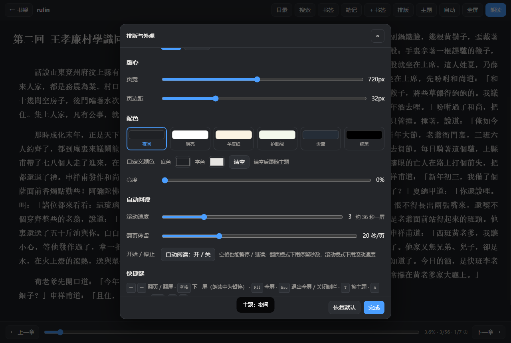 |

| Immersive full screen | Phone · single-column pages |
|---|---|
|  |  |

| Role-based reading | Shelf with one-click resume |
|---|---|
|  |  |

| Highlights & notes | Reading summary |
|---|---|
|  |  |

| English interface | 187 offline voices |
|---|---|
|  |  |

### Features

- **Formats** — TXT (auto-detects UTF-8 / GBK / Big5 / UTF-16) and EPUB, with a built-in ZIP / OPF / NCX / Nav parser and image support.
- **Speech** — 187 offline Chinese speakers sharing a single 61.4 MB fp16 model (the int8 build is only 41 MB but pushes character error rate from 11% to 25% — audibly slurred — so we ship fp16 instead, which halves the size with no audible loss; about 1.5 s for a 20-character line on a phone), grouped into seven measured-pitch bands. 50 curated voices on desktop / 30 on phones, and **any voice in the library can be set as a lead** — switch it right from the playback bar, even mid-sentence. Since 1.14.39 the library lives in the resident pool (same model, different `sid`), so a 19-character line takes 0.92 s. Since 1.14.40 the two 22.05 kHz lead models are no longer bundled, which took the Windows exe from 150 to 125 MB and the APK from 128 to 102 MB.
- **English** — Chinese models know no Latin letters, so English is routed three ways: a bundled-if-present local English model, else the system English voice, else a pause measured by letter count. Never an error, never a fallback to the robotic voice mid-chapter.
- **Role reading** — narration keeps your chosen voice while quoted dialogue switches per character, consistently for the whole book.
- **Listening** — paragraph highlight with auto-scroll, auto-advance to the next chapter, sleep timer, speed control.
- **Resume** — listening position is tracked separately from reading position; one click on a shelf card resumes "chapter N".
- **Reading** — continuous scroll, or whole-screen page turns with **one or two columns** (Auto / 1 / 2; wide screens get two, phones always one). Font size, line height, paragraph gap, letter spacing, first-line indent, **ten typefaces** (Song / YaHei / Hei / Kai / FangSong / ZhongSong / LiSu / YouYuan / DengXian / Mono, each button previewed in its own face), four font weights, justified or ragged right, measure width and side margins are all adjustable.
- **Traditional → Simplified** — a Chinese switch in Settings renders Traditional books in Simplified; body and contents both convert. It is a **same-length substitution** done at display time, so the file is untouched, switching back restores it, and highlight / note / speech positions never drift. Full-text search follows the switch too.
- **Illustrations** — tap any image in an EPUB for a full-screen view; tap anywhere or press Esc to close.
- **Touch** — swipe left/right to turn pages, pinch to change text size (saved on release).
- **Drag & drop** — drop TXT / EPUB / PDF / DOCX / MOBI / AZW3 or a whole `.zip` (or a folder) onto the window to import; dropping while reading does not interrupt you. Archives are unpacked in memory and only books are taken.
- **Appearance** — dark / light / sepia / green / slate / pure black, picked from a card panel in one go, plus your own paper and text colour and a brightness dimmer for reading in the dark.
- **Network share (desktop)** — read straight from a LAN share (SMB): type `\\192.168.1.10\Books`, a mapped drive such as `Z:\books`, or any local path, and its TXT / EPUB are imported as if they were on this machine. Credentials are handled by Windows, so anything File Explorer can open, the reader can scan.
- **Reading clock & breaks** — the toolbar shows the time and how long you have read this session (amber at 30 minutes, red at 60); a reminder offers a break or a ten-minute snooze after your chosen stretch.
- **Auto read** — continuous scrolling, or timed page turns; pause and resume from a pill, and the next chapter starts by itself.
- **Immersive full screen** — both bars slide away and come back when the pointer reaches an edge; F11 and Esc work too.
- **Highlights & notes** — select text for four highlight colours, a note, copy or a share card; the Notes panel lists every annotation by chapter with jump / recolour / edit / delete.
- **Export & summary** — export notes as Markdown; a reading summary shows time read, progress, annotation counts and chapter-by-chapter excerpts.
- **Shelves** — custom shelves, favorites, batch move / remove, edit title and author, whole-folder import, reading time per book.
- **Bilingual** — the entire window, including settings, dialogs and all documentation, switches between Chinese and English.
- **Navigation** — table of contents, full-text search, bookmarks, arrow keys.
- **Data** — everything in local IndexedDB, with export / import backup.
- **Update check** — one click in Settings reads the latest version number, which package fits this device, its size and its sha256. **Never checks by itself** — the app is offline by default and only sends a request when you ask (a ~90 KB JSON, nothing about your device or books). You may opt into a startup check, which still runs at most once a day and stays silent when offline.
- **Privacy** — zero network by default; speech is synthesized on `127.0.0.1`, text never leaves the machine.

### Platforms

| Platform | How |
|---|---|
| **Windows** | `MoYinReader.exe` — full build with the voice pack inside |
| **Android** | `MoYinReader.apk` — page embedded, speech via system TTS |
| **Any system** | Double-click `MoYinReader.html` |
| **Linux / domestic (UOS, Kylin, openEuler)** | `sudo dpkg -i moyin-reader_*.deb`, or unzip the tarball and run the launcher — a 10 MB standalone binary, **no Python needed** (verified on UOS Desktop 20 Professional, x86_64) |
| **macOS** | Unzip, then run `build-macos.sh` on your Mac to produce a `.app` |

The Linux binary only needs `libc` / `libz` / `libpthread` / `libdl` (glibc 2.28+). On aarch64 (Phytium / Kunpeng) and loongarch64 (Loongson) it falls back to the Python or web route; `build-linux.sh` builds a native binary on such a machine.

### Builds

| File | Size | Notes |
|---|---|---|
| `MoYinReader.exe` | ~149 MB | Full build, voice pack appended inside the exe, resident TTS engine built in; since 1.14.20 it also carries the English voice (`en-ljs`, ~39 MB) |
| `MoYinReader_Lite.exe` | ~38 MB | Needs a `VoicePack` folder (~171 MB) next to it |
| `MoYinReader.html` | ~492 KB | Standalone web build |
| `MoYinReader.apk` | ~101 MB | Android full build: page + neural TTS engine with all three model sets (two leads + 187-speaker library) |
| `moyin-reader_*_amd64.deb` | ~9.7 MB | UOS / Kylin / openEuler, installs into the app menu |
| `MoYinReader-Linux-*.tar.gz` | ~9.8 MB | Portable build, same x86_64 binary, unzip and run |
| `MoYinReader-macOS-*.zip` | ~157 KB | Source + `build-macos.sh`; run it once on your Mac to get a `.app` |

Prebuilt binaries: **[Releases](https://github.com/podcatcher962/moyin-reader/releases)** — or open the **[web version](https://podcatcher962.github.io/moyin-reader/)** and install nothing.

### Build from source

Only source lives in this repo — `exe`, `apk` and the speech model are not committed (they are large, and the model is a third-party asset). `docs/download/` holds a lightweight download page only; the APK itself comes from Releases, because a 100 MB binary on Pages has to be re-synced to the CDN on every release and the deployment times out.

> **Android download stalls?** Use the download page — `https://podcatcher962.github.io/moyin-reader/download/`. It offers the official GitHub link (no third party in between) side by side with optional mirrors (`gh-proxy.com` and friends are third-party reverse proxies: **they can see your IP and User-Agent**, so use them only when the direct link fails). The page shows the version, byte count and sha256 so you can verify the file yourself.
>
> Open it in a real browser — WeChat / QQ in-app browsers block apk downloads (tap "open in browser"). Allow "unknown sources" when the system asks.

```bash
python _bump.py --check         # verify the version number is identical in all 10 places
python build.py                 # bundle the web app  → MoYinReader.html
python VoicePack/install.py     # fetch engine + model (~90 MB, GitHub Releases)
python _pkg_win/build_exe.py    # optional Windows exe (needs pyinstaller, pywebview, pythonnet)
python _pkg_apk/build_apk.py    # optional Android apk (needs JDK 17 + build-tools 34;
                                #   set MOYIN_ANDROID_BUILD and MOYIN_KS_PASS first)
```

### License

MIT © 2026 Lanlan Eternal. Third-party components keep their own licenses — see [LICENSE](LICENSE) and [THIRD-PARTY-NOTICES.md](THIRD-PARTY-NOTICES.md).

### Disclaimer

For reading e-books you legally own. No copyrighted content is provided, downloaded or decrypted, and no DRM is bypassed. Provided "as is", without warranty of any kind.
