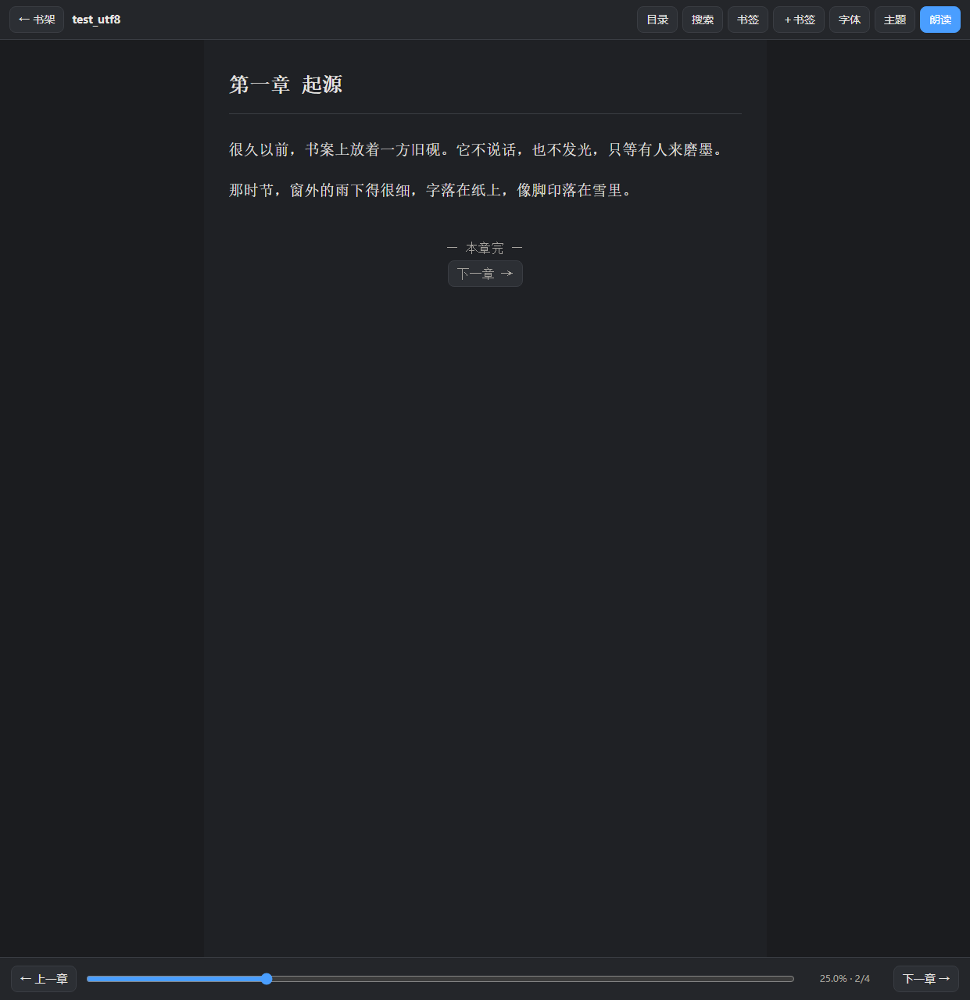
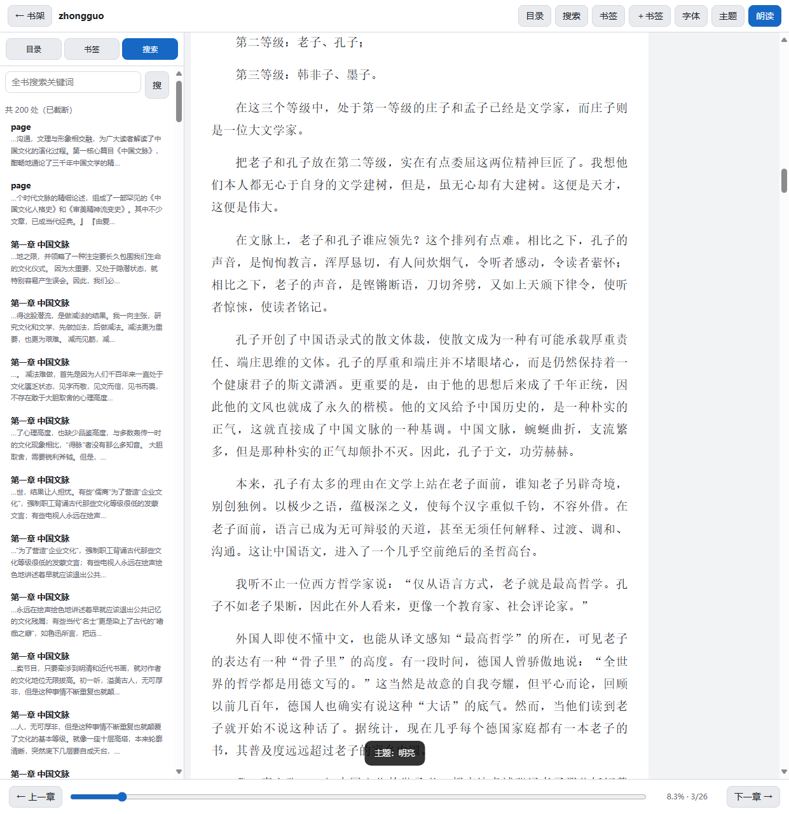

# 墨吟 · MoYin Reader

**[中文](#中文) | [English](#english)**

一个单文件、默认离线的中文 TXT / EPUB 阅读器，带朗读。174 个离线中文说话人（148 女 26 男，精选 11 个直接可选），支持分角色朗读，Windows 一个 exe 直接跑，安卓一个 apk，浏览器双击 HTML 也能用。

> 名字取「以墨为文、吟而出声」：把纸上的字念出来。与任何同名公司、配音平台、有声主播无关。

---

## 中文

### 它是什么

把一本书丢进去，安静地读，或者让它念给你听。没有账号、没有广告、不联网也能用，书和进度都存在本机。

### 截图

| 夜间阅读 | 明亮阅读 |
|---|---|
|  |  |

| 分角色朗读 | 书架 · 一键续听 |
|---|---|
|  |  |

### 功能

| 类别 | 说明 |
|---|---|
| 📚 格式 | TXT（自动识别 UTF-8 / GBK / Big5 / UTF-16）、EPUB（内置 ZIP/OPF/NCX/Nav 解析，正文与插图都支持） |
| 🗣️ 朗读 | 174 个离线中文说话人共用一份 29 MB 模型，按实测音高分 7 档；朗读条随时切换 |
| 🎭 分角色 | 旁白用所选声线，引号里的对白按人物自动换声（同一人物全书同一声音） |
| ⏯️ 听书 | 段落高亮自动跟随、念完自动接下一章、定时停止、语速调节、整句朗读保语调 |
| 🔖 续听 | 「听到哪」与「读到哪」分开记，书架卡片一键「续听 · 第 N 章」接着念 |
| ✍️ 阅读 | 夜间 / 明亮 / 羊皮纸三主题，字号、行距、页宽、字体、两端对齐可调 |
| 🔍 导航 | 目录跳章、全文搜索、书签、章节内跳转、键盘 ← → 空格 |
| 💾 数据 | IndexedDB 本机存储，可导出/导入备份（含书籍文件），换设备不丢 |
| 🔒 隐私 | 默认零联网；语音在本机 127.0.0.1 合成，朗读文字不出本机 |

### 三个版本

| 版本 | 体积 | 说明 |
|---|---|---|
| `MoYinReader.exe` | 约 47 MB | **完整版**，语音库打包在 exe 尾部，只拷这一个文件就能听，首次启动自动释放到缓存 |
| `MoYinReader_Lite.exe` | 约 17 MB | 轻量版，需同目录放 `VoicePack` 文件夹（约 53 MB） |
| `MoYinReader.html` | 约 120 KB | 单文件网页版，双击即用；朗读走系统语音，点击可连接本机语音引擎 |
| `MoYinReader.apk` | 约 100 KB | 安卓壳，页面内嵌，朗读走系统 TTS |

### 使用

1. 双击 `MoYinReader.exe`（或 `MoYinReader.html`）。
2. 「＋ 导入书籍」选一本 `.txt` / `.epub`。
3. 点书打开，点右上「朗读」开始听；朗读条最左边可换声线。
4. 回到书架能看见「▶ 续听 · 第 N 章」，接着上次听的地方继续。

### 语音是怎么来的

朗读用的是开源引擎 [sherpa-onnx](https://github.com/k2-fsa/sherpa-onnx) 加一份 AISHELL3 中文多说话人 VITS 模型，全部在本机 CPU 上跑：不联网、不收费、不需要账号和 Key。174 个说话人共用同一份模型，只是切换说话人编号，所以**放开到 174 个也完全不增加体积**。


### 从源码构建

仓库只放源码，`exe` / `apk` / 语音模型都不入库（体积大，且模型是第三方资产）。克隆后按下面两步即可复现：

```bash
# 1) 生成单文件网页版（纯 Python 标准库，无需依赖）
python build.py                       # → MoYinReader.html

# 2) 拉语音引擎与模型（约 55 MB，走 GitHub Release，带 gh-proxy 备用线路）
python VoicePack/install.py           # → VoicePack/engine + VoicePack/models

# 可选：打包 Windows exe（需要 pip install pyinstaller pywebview pythonnet）
python _pkg_win/build_exe.py          # → MoYinReader.exe / MoYinReader_Lite.exe

# 可选：打包安卓 apk（需要 JDK 17 + Android SDK build-tools 34）
set MOYIN_ANDROID_BUILD=<你的构建目录>
set MOYIN_KS_PASS=<签名密钥库口令>
python _pkg_apk/build_apk.py          # → MoYinReader.apk
```

目录结构：

```
app.js  shell.html  zipcore.js     前端（无框架，build.py 内联成一个 HTML）
build.py                           单文件 HTML 打包器
VoicePack/tts_server.py            本机语音服务（127.0.0.1:8177，174 声线）
VoicePack/install.py               引擎与模型下载器
VoicePack/voice_table.json         174 个说话人的实测音高表
_pkg_win/app.py                    Windows 外壳（pywebview + 内嵌 HTTP）
_pkg_win/build_exe.py              exe 打包 + 验收
_pkg_apk/TtsBridge.java            安卓 TTS 桥（系统语音）
_pkg_apk/build_apk.py              apk 打包 + 体检
_cdp_verify.js                     115 项界面回归（headless Edge，CDP）
_check_voices.js  _check_role.js   声线 / 分角色朗读回归
_unit_zip.js                       ZIP 解压内核单测（482 项）
```

回归脚本请配合 `_samples/` 使用：`expect.json` 已入库，书籍样本因版权不入库，自备一本 `.txt` 或 `.epub` 放进 `_samples/` 即可。

### 许可与致谢

本项目以 **MIT 许可证**发布，版权 © 2026 永远的兰兰（Lanlan Eternal）。第三方组件（sherpa-onnx、AISHELL3 模型、pywebview、pythonnet、PyInstaller）各自遵循其原始许可证，详见 [LICENSE](LICENSE) 与 [THIRD-PARTY-NOTICES.md](THIRD-PARTY-NOTICES.md)（也写在软件内「开源与许可」）。

### 免责

仅供阅读自己合法持有的电子书使用；不提供、不获取、不破解任何受版权保护的内容，不绕过 DRM。导入文件、书签、进度只存在本机。软件按「现状」提供，不附带任何担保。

---

## English

A single-file, offline-first Chinese TXT / EPUB reader with text-to-speech. 174 offline Chinese speakers (148 female, 26 male; 11 curated by default), with role-based reading that switches voices per character in dialogue. One portable exe on Windows, one apk on Android, or just double-click the HTML.

### Screenshots

| Dark reading | Light reading |
|---|---|
|  |  |

| Role-based reading | Shelf with one-click resume |
|---|---|
|  |  |

### Features

- **Formats** — TXT (auto-detects UTF-8 / GBK / Big5 / UTF-16) and EPUB, with a built-in ZIP / OPF / NCX / Nav parser and image support.
- **Speech** — 174 offline Chinese speakers sharing a single 29 MB model, grouped by measured pitch; switch voices right from the playback bar, even mid-sentence.
- **Role reading** — narration keeps your chosen voice while quoted dialogue switches per character, consistently for the whole book.
- **Listening** — paragraph highlight with auto-scroll, auto-advance to the next chapter, sleep timer, speed control.
- **Resume** — listening position is tracked separately from reading position; one click on a shelf card resumes "chapter N".
- **Reading** — dark / light / sepia themes, adjustable font size, line height, page width and family.
- **Navigation** — table of contents, full-text search, bookmarks, arrow keys.
- **Data** — everything in local IndexedDB, with export / import backup.
- **Privacy** — zero network by default; speech is synthesized on `127.0.0.1`, text never leaves the machine.

### Builds

| File | Size | Notes |
|---|---|---|
| `MoYinReader.exe` | ~47 MB | Full build, voice pack appended inside the exe |
| `MoYinReader_Lite.exe` | ~17 MB | Needs a `VoicePack` folder (~53 MB) next to it |
| `MoYinReader.html` | ~120 KB | Standalone web build |
| `MoYinReader.apk` | ~100 KB | Android shell with the page embedded |

### Build from source

Only source lives in this repo — `exe` / `apk` and the speech model are not committed (they are large, and the model is a third-party asset).

```bash
python build.py                 # bundle the web app  → MoYinReader.html
python VoicePack/install.py     # fetch engine + model (~55 MB, GitHub Releases)
python _pkg_win/build_exe.py    # optional Windows exe (needs pyinstaller, pywebview, pythonnet)
python _pkg_apk/build_apk.py    # optional Android apk (needs JDK 17 + build-tools 34;
                                #   set MOYIN_ANDROID_BUILD and MOYIN_KS_PASS first)
```

### License

MIT © 2026 Lanlan Eternal. Third-party components keep their own licenses — see [LICENSE](LICENSE) and [THIRD-PARTY-NOTICES.md](THIRD-PARTY-NOTICES.md).

### Disclaimer

For reading e-books you legally own. No copyrighted content is provided, downloaded or decrypted, and no DRM is bypassed. Provided "as is", without warranty of any kind.
